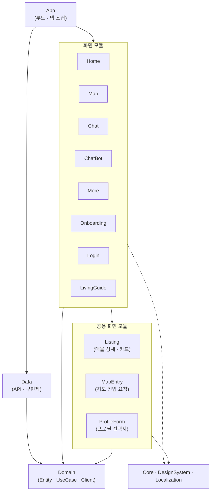

  

#  Kohere

> Your Housing Platform in Korea

**복잡한 한국 주거 용어를 몰라도, 몇 번의 선택만으로 맞는 매물을 추천받고 탐색부터 신청까지 앱 하나로 끝내는 "외국인 맞춤형 주거 플랫폼"**

 

##  외국인에게 한국 집 구하기가 어려운 이유

| “원하는 조건에 맞는 집을 찾기가 어려워요.”

| “외국인은 안되는 집이 많은데, 알기 어려워요”

| “생각보다 주거 문화가 많이 달라서 헤맸어요.”

 

##  Kohere가 해결하는 방법

### ① 챗봇으로 간편한 필터링

입국 목적, 지역, 예산, 선호도를 기반으로 한 챗봇이 맞춤 매물을 추천해줘요

### ② 매물 탐색부터 신청까지

매물을 찾는 것에서 끝나지 않고, 입주 신청까지 한번에 진행해요

### ③ 한국 생활 팁

한국생활을 도와주는 정보들을 퀴즈와 팁 형식으로 쉽게 습득해요

 

##  앱 주요 화면

| 맞춤 매물 추천 챗봇 | 지도 기반 매물 탐색 | 매물 상세 · 저장 |
| :-------------: | :-------------: | :----------: |
|  |  |  |

| 입주 신청 | 실시간 채팅 | 한국 생활 가이드 · 퀴즈 |
| :-----: | :------: | :----------------: |
|  |  |  |

 

##  iOS Developers

|     |       |
| :--------------------------------------------------------------------------: | :--------------------------------------------------------------------------: |
|                   [송규섭](https://github.com/SongKyuSeob)                   |                    [김수민](https://github.com/gleamminn)                    |
| `iOS Developer` `지도 · 매물 · 더보기` `Core · DesignSystem · Tuist` | `iOS Developer` `홈 · 챗봇 · 채팅 · 온보딩 · 로그인` `Domain · Data` |

 

##  Tech Stack

| 분류              | 사용 기술                                                    |
| ----------------- | ------------------------------------------------------------ |
| UI · 상태 관리    | SwiftUI, The Composable Architecture (TCA)                   |
| 프로젝트 · 모듈   | Tuist (정적 프레임워크 16개 모듈)                            |
| 네트워크 · 실시간 | Alamofire, SwiftStomp (WebSocket)                            |
| 지도              | Naver Maps SDK                                               |
| 로그인 · 알림     | Sign in with Apple, Google Sign-In, Firebase Cloud Messaging |
| 이미지            | Kingfisher                                                   |
| 코드 품질         | SwiftLint, CodeRabbit                                        |

 

##  Architecture

기능 화면마다 모듈을 나누고, 앱 타깃은 모듈을 조립하는 역할만 맡습니다.

화면 모듈은 실제로 띄우는 화면에만 의존하고, 여러 탭이 함께 쓰는 화면은 공용 모듈로 내려 순환 의존을 막습니다.

| 레이어                             | 역할                                                        |
| ---------------------------------- | ----------------------------------------------------------- |
| App                                | 루트 Reducer와 탭 구성. 각 화면 모듈과 Data의 구현체를 연결 |
| 화면 모듈                          | SwiftUI View + TCA Reducer. 화면 하나 또는 탭 하나 단위     |
| Domain                             | Entity, UseCase, Client 인터페이스(TCA Dependency)          |
| Data                               | API 호출과 Client의 실제 구현(`liveValue`)                  |
| Core · DesignSystem · Localization | 공용 유틸, 디자인 토큰·컴포넌트, 다국어 문자열              |

 

##  AI-Assisted 개발 방식

AI와 개발 기준을 공유하기 위해 프로젝트 규칙과 작업 절차를 Markdown으로 관리했습니다. 작업별 스킬에서 관련 문서를 참조하도록 구성해, 기능 구현과 리뷰에서 같은 기준을 따르도록 했습니다.

| 문서                                   | 개발에 활용한 기준                                     |
| -------------------------------------- | ------------------------------------------------------ |
| [AGENTS.md](AGENTS.md)                 | 작업 규칙, 문서 참조 경로, 작업별 스킬 선택, 검증 범위 |
| [Architecture](docs/architecture.md)   | 레이어 책임, 모듈 의존 방향, TCA 상태·내비게이션 구성  |
| [Design System](docs/design-system.md) | 디자인 기준의 출처와 토큰·컴포넌트 적용 규칙           |
| [작업별 Skills](.agents/skills)        | 기획·구현·리뷰·UI 조정 등 작업별 절차                  |

기능 구현 스킬은 기존 코드 패턴과 아키텍처 문서를 확인하도록 하고, UI 조정 스킬은 제공된 Figma 기준값과 기존 디자인 토큰을 우선하도록 정의했습니다. 검증 범위와 미검증 항목을 보고하는 방식도 문서에 명시했습니다.

 

##  모듈화로 증분 빌드 시간 약 70% 단축

[[모듈화 과정과 증분 빌드 개선] 자세히보기](docs/modularization.md)

### 문제

모듈 변경이 있는 빌드에서 Emit Swift Module에 10.x~12.x초가 소요됐습니다. 두 명이 동시에 작업하면 `project.pbxproj` 충돌도 잦았습니다.

### 해결

Tuist로 프로젝트를 코드로 관리하고, 레이어부터 화면까지 16개 모듈로 분리했습니다. 여러 화면에서 쓰는 기능은 공용 모듈(Listing·MapEntry·ProfileForm)로 분리했습니다.

### 결과

파일 1개 수정 후 빌드 시간이 지도는 14.2초 → 4.0초, 홈은 14.1초 → 4.2초로 줄어 약 70% 단축됐습니다. Domain 파일 수정 시에는 14.2초 → 3.0초로 줄었습니다. (비교 그래프 기준, 6회 측정한 중앙값)

  

