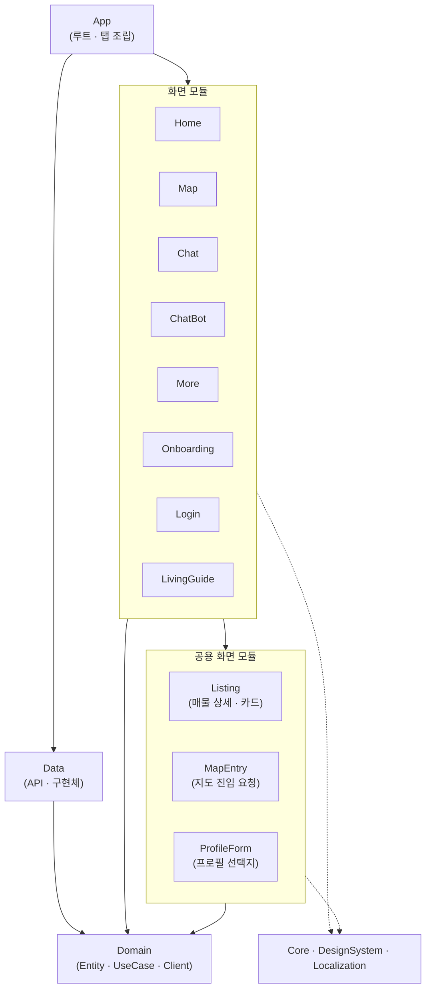

<p align="center">
  
</p>

#  Kohere

> 한국에서 집 찾기, 이제 용어부터 막히지 않게

**한국 부동산 용어를 몰라도 나에게 맞는 집을 찾을 수 있도록 돕는, 외국인을 위한 주거 큐레이션 앱**

<a href="https://apps.apple.com/app/idXXXXXXXXXX"></a>

<br>

##  외국인에게 한국 집 구하기가 어려운 이유

- **낯선 용어** 보증금, 전세, 관리비처럼 집을 고르는 데 꼭 필요한 정보가 한국식 용어로만 쓰여 있다.
- **세우기 어려운 기준** 한국 시세와 계약 관행을 몰라 어떤 조건이 나에게 맞는지 판단하기 어렵다.
- **막막한 소통** 매물을 찾아도 집주인에게 묻고 계약까지 이어 가는 과정이 막막하다.

##  Kohere가 해결하는 방법

1. 낯선 용어 → **영어 지원 · 원화와 달러를 함께 표시하는 가격**으로 바로 이해
2. 세우기 어려운 기준 → **챗봇 진단**으로 몇 가지 질문에 답하면 맞는 조건과 매물을 추천
3. 막막한 소통 → **임대인과의 실시간 채팅 · 입주 신청**까지 앱 안에서 해결

<br>

##  주요 기능

| 맞춤 진단 | 지도 탐색 | 매물 상세 | 채팅 | 생활 가이드 |
| :---: | :---: | :---: | :---: | :---: |
|  |  |  |  |  |
| 질문에 답하면<br/>맞는 조건과 매물 추천 | 월세·보증금·방 조건으로<br/>지도에서 매물 찾기 | 원화·달러 가격 보고<br/>바로 입주 신청 | 임대인과<br/>실시간 대화 | 한국 생활 정보를<br/>퀴즈와 가이드로 |

<br>

##  iOS Developers

|  |  |
| :---: | :---: |
| [송규섭](https://github.com/SongKyuSeob) | [김수민](https://github.com/gleamminn) |
| `iOS Developer`<br/>`Core · DesignSystem · Tuist`<br/>`지도 · 매물 · 더보기` | `iOS Developer`<br/>`Domain · Data`<br/>`홈 · 챗봇 · 채팅 · 온보딩 · 로그인` |

<br>

##  Tech Stack

| 분류 | 사용 기술 |
| --- | --- |
| UI · 상태 관리 | SwiftUI, The Composable Architecture (TCA) |
| 프로젝트 · 모듈 | Tuist (정적 프레임워크 16개 모듈) |
| 네트워크 · 실시간 | Alamofire, SwiftStomp (WebSocket) |
| 지도 | Naver Maps SDK |
| 로그인 · 알림 | Sign in with Apple, Google Sign-In, Firebase Cloud Messaging |
| 이미지 | Kingfisher |
| 코드 품질 | SwiftLint, CodeRabbit |

<br>

##  Architecture

기능 화면마다 모듈을 나누고, 앱 타깃은 모듈을 조립하는 역할만 맡는다. 화면 모듈은 실제로 띄우는 화면에만 의존하고(예: 지도 → 챗봇 진단), 여러 탭이 함께 쓰는 화면은 공용 모듈로 내려 순환 의존을 막는다.



| 레이어 | 역할 |
| --- | --- |
| App | 루트 Reducer와 탭 구성. 각 화면 모듈과 Data의 구현체를 연결 |
| 화면 모듈 | SwiftUI View + TCA Reducer. 화면 하나 또는 탭 하나 단위 |
| Domain | Entity, UseCase, Client 인터페이스(TCA Dependency) |
| Data | API 호출과 Client의 실제 구현(`liveValue`) |
| Core · DesignSystem · Localization | 공용 유틸, 디자인 토큰·컴포넌트, 다국어 문자열 |

<br>

##  모듈화로 빌드 시간 70% 줄이기

**문제** 앱 전체(약 3만 줄)가 하나의 모듈이라, 파일 하나만 고쳐도 앱 전체의 모듈 인터페이스를 다시 생성(Emit 약 10초)했다. 두 명이 동시에 작업하면 `project.pbxproj` 충돌도 잦았다.

**해결** Tuist로 프로젝트를 코드로 관리하고, 레이어(Core·Domain·Data·DesignSystem)부터 화면까지 16개 모듈로 분리했다. 화면끼리 얽힌 의존은 공용 모듈(Listing·MapEntry·ProfileForm)로 풀었다.

**결과** 수정한 모듈만 다시 빌드한다. 파일 1개 수정 후 증분 빌드가 약 14초에서 3~4초로 줄었다. (같은 날 같은 맥에서 전후 각 6회 측정한 중간값)

<p align="center">
  
</p>

<br>

##  협업 방식

- **브랜치** `dev` 기준, 이슈마다 `type/#이슈번호` 브랜치를 만들고 PR로 머지
- **커밋** `type: 내용` 형식 (feat, fix, refactor, del 등)
- **리뷰** 팀원 리뷰와 CodeRabbit 자동 리뷰. Tuist 도입 후 `project.pbxproj`를 커밋하지 않아 동시 작업 충돌 없음

<br>

<details>
<summary> <b>개발 환경 설정</b></summary>

<br>

```bash
mise install          # Tuist 4.211.0
cd Kohere
tuist install
tuist generate
```

- Xcode 26.2 필요 (Swift 6.4는 TCA 1.26.0을 빌드하지 못해 `mise.local.toml`로 `DEVELOPER_DIR` 지정)
- `Config/Secrets.xcconfig`, `GoogleService-Info.plist`는 팀 내부에서 별도 전달

</details>
