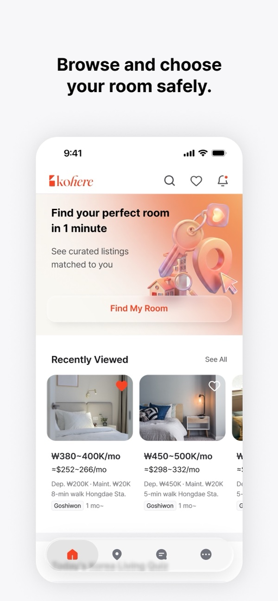
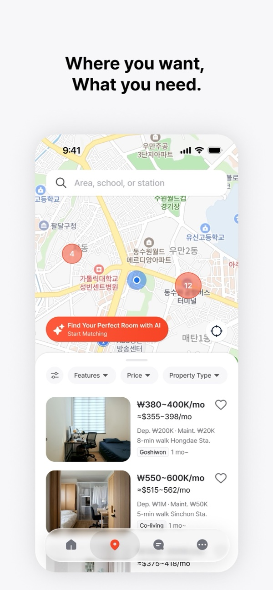
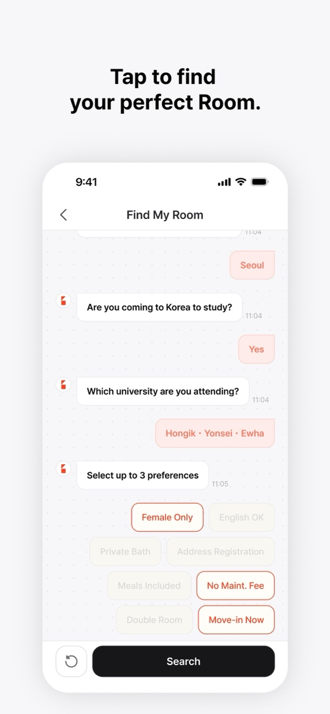
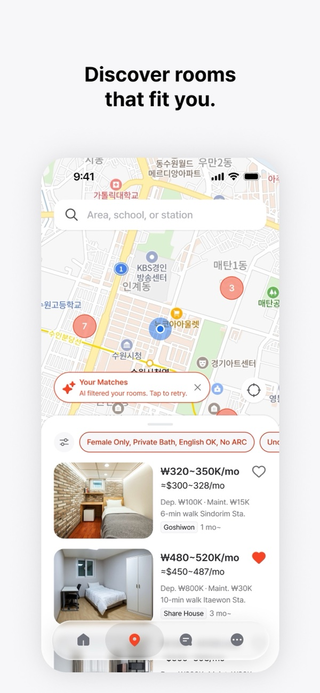
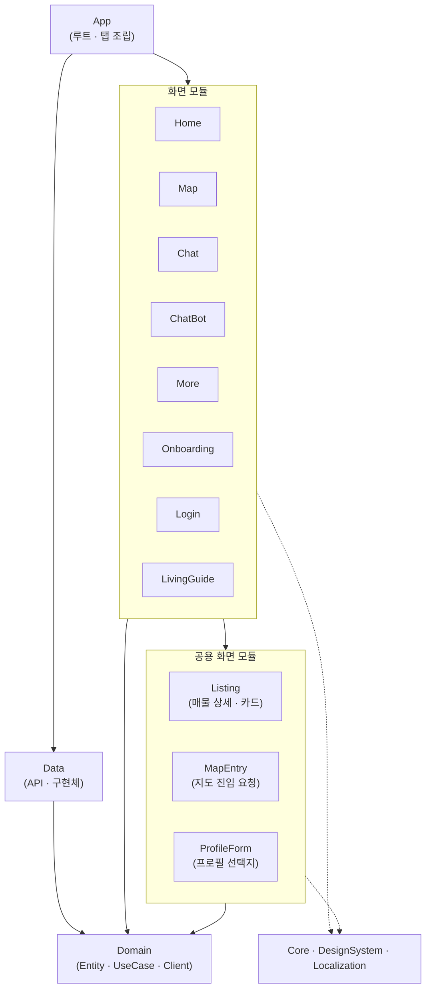
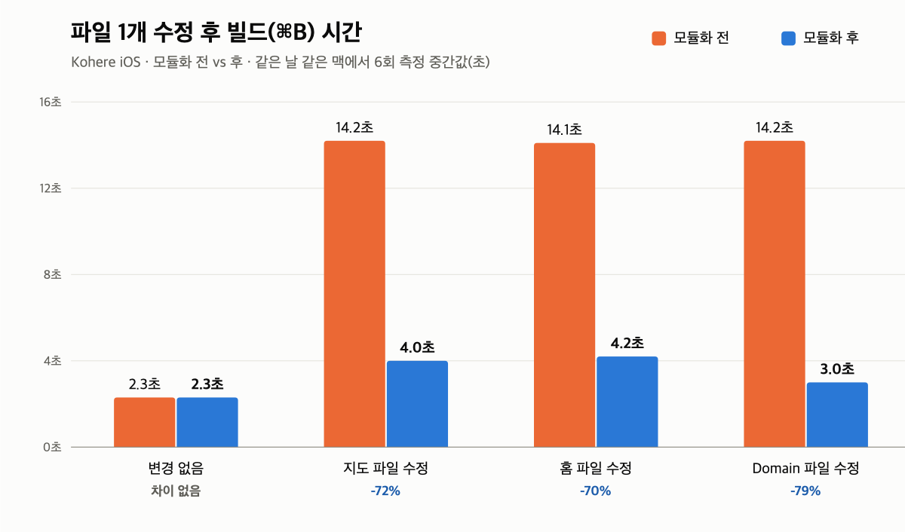

  

#  Kohere

> Your Housing Platform in Korea

**복잡한 한국 주거 용어를 몰라도, 몇 번의 선택만으로 맞는 매물을 추천받고 탐색부터 신청까지 앱 하나로 끝내는 외국인 맞춤형 주거 플랫폼**

 

##  외국인에게 한국 집 구하기가 어려운 이유

- 낯선 한국 부동산 용어
- 부담스러운 임대인 연락
- 믿을 만한 한국 생활 정보 부족

##  Kohere가 해결하는 방법

1. **맞춤 매물 챗봇** 지역·목적·예산·선호만 고르면 맞는 매물을 추천
2. **탐색부터 신청까지 한 번에** 임대인에게 따로 연락하지 않고, 앱에서 원하는 날짜와 기간을 골라 바로 신청
3. **한국 생활 꿀팁** 계좌 개설·대중교통·사기 유형·건강 정보와 하루 한 번 퀴즈

 

##  주요 기능

| 홈 | 지도 탐색 | 맞춤 매물 챗봇 | 추천 결과 |
| :---: | :---: | :---: | :---: |
|  |  |  |  |
| 최근 본 매물과 1분 맞춤 추천 진입 | 원하는 지역에서 조건별로 매물 탐색 | 질문에 답하면 조건에 맞는 매물 검색 | 진단 조건으로 걸러진 매물을 지도와 목록으로 |

 

##  iOS Developers

|  |  |
| :---: | :---: |
| [송규섭](https://github.com/SongKyuSeob) | [김수민](https://github.com/gleamminn) |
| `iOS Developer` `Core · DesignSystem · Tuist` `지도 · 매물 · 더보기` | `iOS Developer` `Domain · Data` `홈 · 챗봇 · 채팅 · 온보딩 · 로그인` |

 

##  Tech Stack

| 분류 | 사용 기술 |
| --- | --- |
| UI · 상태 관리 | SwiftUI, The Composable Architecture (TCA) |
| 프로젝트 · 모듈 | Tuist (정적 프레임워크 16개 모듈) |
| 네트워크 · 실시간 | Alamofire, SwiftStomp (WebSocket) |
| 지도 | Naver Maps SDK |
| 로그인 · 알림 | Sign in with Apple, Google Sign-In, Firebase Cloud Messaging |
| 이미지 | Kingfisher |
| 코드 품질 | SwiftLint, CodeRabbit |

 

##  Architecture

기능 화면마다 모듈을 나누고, 앱 타깃은 모듈을 조립하는 역할만 맡습니다. 화면 모듈은 실제로 띄우는 화면에만 의존하고(예: 지도 → 챗봇 진단), 여러 탭이 함께 쓰는 화면은 공용 모듈로 내려 순환 의존을 막습니다.

| 레이어 | 역할 |
| --- | --- |
| App | 루트 Reducer와 탭 구성. 각 화면 모듈과 Data의 구현체를 연결 |
| 화면 모듈 | SwiftUI View + TCA Reducer. 화면 하나 또는 탭 하나 단위 |
| Domain | Entity, UseCase, Client 인터페이스(TCA Dependency) |
| Data | API 호출과 Client의 실제 구현(`liveValue`) |
| Core · DesignSystem · Localization | 공용 유틸, 디자인 토큰·컴포넌트, 다국어 문자열 |

 

##  모듈화로 증분 빌드 시간 70% 개선

**문제** 앱 전체(약 3만 줄)가 하나의 모듈이라, 파일 하나만 고쳐도 앱 전체의 모듈 인터페이스를 다시 생성(Emit 약 10초)했습니다. 두 명이 동시에 작업하면 `project.pbxproj` 충돌도 잦았습니다.

**해결** Tuist로 프로젝트를 코드로 관리하고, 레이어(Core·Domain·Data·DesignSystem)부터 화면까지 16개 모듈로 분리했습니다. 화면끼리 얽힌 의존은 공용 모듈(Listing·MapEntry·ProfileForm)로 풀었습니다.

**결과** 수정한 모듈만 다시 빌드합니다. 파일 1개 수정 후 증분 빌드가 약 14초에서 3~4초로 줄었습니다. (같은 날 같은 맥에서 전후 각 6회 측정한 중간값)

  

 

##  협업 방식

- **브랜치** `dev` 기준, 이슈마다 `type/#이슈번호` 브랜치를 만들고 PR로 머지
- **커밋** `type: 내용` 형식 (feat, fix, refactor, del 등)
- **리뷰** 팀원 리뷰와 CodeRabbit 자동 리뷰. Tuist 도입 후 `project.pbxproj`를 커밋하지 않아 동시 작업 충돌 없음
