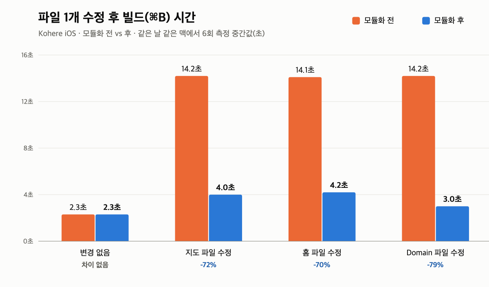

# 모듈화 과정과 증분 빌드 개선

Kohere의 앱 코드를 16개 정적 프레임워크 모듈로 분리하고, Tuist로 프로젝트 구성을 관리하도록 전환했습니다. 증분 빌드 시간은 약 14초에서 약 4초로 줄었습니다.

이 문서는 모듈을 나눈 기준과 의존 관계를 해결한 과정, 빌드 시간 비교를 설명합니다. 현재 코드 구조와 개발 규칙은 [Architecture](architecture.md)에 정리되어 있습니다.

## 1. 분리 전 문제

앱 코드가 하나의 모듈에 모여 있어, 화면 간 참조와 공용 코드의 소유권을 분리할 필요가 있었습니다. 두 개발자가 함께 작업하면서 `project.pbxproj` 충돌도 자주 발생했습니다.

모듈에 변경이 있을 때 전체 빌드는 15~17초대였고, 그중 Emit Swift Module에 10~12초대가 소요됐습니다. 변경이 없을 때의 2~4초대와 차이가 커, 코드 수정 후 반복하는 빌드의 대기 시간을 줄이고자 했습니다.

목표는 자주 수정하는 화면의 빌드 범위를 줄이고, 프로젝트 구성과 모듈 간 의존을 코드로 관리하는 것이었습니다.

## 2. 분리 기준과 선택 이유

### 기반 레이어를 먼저 분리

화면이 사용하는 공용 코드와 데이터 경계를 먼저 만들고, 이후 화면을 옮기는 순서로 진행했습니다. 현재 코드는 다음 역할로 나뉩니다.

| 구분            | 모듈                                                                  | 분리 기준                                                          |
| --------------- | --------------------------------------------------------------------- | ------------------------------------------------------------------ |
| 기반            | Core · Localization · DesignSystem                                    | 범용 유틸, 문자열, 디자인 리소스의 책임 구분                       |
| 비즈니스·데이터 | Domain · Data                                                         | Entity·UseCase·Client 인터페이스와 외부 데이터 구현 분리           |
| 공용 기능       | Listing · MapEntry · ProfileForm                                      | 여러 화면이 사용하는 매물 기능, 지도 진입 계약, 프로필 선택지 분리 |
| 화면            | LivingGuide · More · Onboarding · Login · ChatBot · Chat · Map · Home | 화면 흐름과 TCA 상태를 담당하는 단위                               |

Listing에는 매물 관련 화면과 Reducer를, MapEntry와 ProfileForm에는 여러 화면이 함께 쓰는 타입을 배치했습니다. 모듈의 경계는 코드의 양보다 기능의 책임과 공유 범위에 맞췄습니다. 앱·테스트 타깃을 제외한 모듈 수는 16개입니다.

### 프로젝트 구성을 Tuist로 이전

타깃·의존성·리소스·빌드 설정은 [Project.swift](../Kohere/Project.swift)에 선언합니다. 모듈의 반복 설정은 [Module.swift](../Kohere/Tuist/ProjectDescriptionHelpers/Module.swift)에 모았습니다. 이 헬퍼는 정적 프레임워크를 생성하며, 각 모듈은 필요한 의존성과 설정을 추가합니다.

## 3. 화면 간 의존 관계를 해결한 방법

### Listing: 여러 탭에서 여는 매물 기능

홈·지도·채팅·더보기는 매물 상세나 관련 목록을 사용합니다. 매물 상세를 특정 탭에 두면 다른 탭이 그 탭의 모듈을 참조하게 됩니다.

매물 상세·신청·검색·최근 본·저장 목록과 관련 공용 UI를 [KohereListing](../Kohere/KohereListing)에 모았습니다. 각 탭은 필요한 매물 기능을 Listing에서 사용하고, Listing은 호출한 탭 모듈을 알 필요가 없도록 경계를 구성했습니다.

### MapEntry: 지도 화면과 지도 진입 요청의 분리

지도는 챗봇을 열 수 있고, 챗봇은 진단 완료 후 지도에 추천 결과 표시를 요청합니다. 챗봇이 지도 Feature 타입에 직접 의존하면 지도 → 챗봇 → 지도 방향의 순환 의존이 생길 수 있습니다.

[MapEntryRequest.swift](../Kohere/KohereMapEntry/MapEntryRequest.swift)에 일반 탐색과 진단 결과 표시 요청을 정의하고, 필터 타입도 MapEntry로 분리했습니다. 챗봇은 지도 구현을 참조하는 대신 요청을 전달하고, 앱의 조립 계층이 지도 진입을 연결합니다.

```text
Map → ChatBot → MapEntry
Map → MapEntry
App → 각 화면의 전환 연결
```

### ProfileForm: 온보딩과 프로필 수정의 공유 선택지

온보딩과 더보기의 프로필 수정은 입력 선택지를 함께 사용합니다. 선택지를 어느 한 화면 모듈에 두면 다른 화면이 그 모듈 전체에 의존하게 됩니다.

공유하는 [DropdownMenuOption.swift](../Kohere/KohereProfileForm/DropdownMenuOption.swift)를 ProfileForm으로 옮겨, 온보딩과 더보기가 같은 선택지 타입을 사용하도록 했습니다. 화면별 입력 흐름과 상태는 각 화면 모듈에 유지합니다.

## 4. 변경 유무에 따른 빌드 시간

두 개발자의 빌드에서 코드 변경 유무에 따른 시간 차이를 확인했습니다.

| 개발자 | 모듈 변경 여부 | 전체 빌드 시간 | Emit Swift Module |
| ------ | -------------- | -------------- | ----------------- |
| 규섭   | 변경 있음      | 15.x초         | 10.x초            |
| 규섭   | 변경 없음      | 2.x초          | —                 |
| 수민   | 변경 있음      | 17.x초         | 12.x초            |
| 수민   | 변경 없음      | 4.x초          | —                 |

변경이 있는 빌드에서는 Emit Swift Module이 전체 시간의 큰 비중을 차지했습니다. 위 표는 변경 유무에 따른 차이를 보여주며, 모듈화의 효과는 다음의 전후 비교로 확인했습니다.

## 5. 모듈화 전후 비교 결과

동일한 Mac에서 모듈화 전후 빌드 시간을 비교했습니다. 각 시나리오에서 파일 1개를 수정한 뒤 빌드했으며, 수치는 6회 측정한 중앙값입니다.

| 변경 시나리오    | 모듈화 전 | 모듈화 후 | 시간 단축률 |
| ---------------- | --------- | --------- | ----------- |
| 변경 없음        | 2.3초     | 2.3초     | 차이 없음   |
| 지도 파일 수정   | 14.2초    | 4.0초     | 72%         |
| 홈 파일 수정     | 14.1초    | 4.2초     | 70%         |
| Domain 파일 수정 | 14.2초    | 3.0초     | 79%         |



지도·홈 파일 수정 후 빌드 시간은 약 70%, Domain 파일 수정 후에는 약 79% 줄었습니다. 변경이 없는 빌드는 전후 모두 2.3초로 같았습니다.

## 6. 모듈 분리에 맞춘 설정

### 리소스와 생성 코드

에셋과 문자열을 사용하는 모듈에 리소스를 배치하고, 모듈 밖에서도 접근할 수 있도록 심볼 생성 방식을 정리했습니다. 에셋 접근자는 Tuist의 커스텀 템플릿으로 생성하고, 문자열 접근자 생성 스크립트는 Localization 모듈의 빌드 단계에 연결했습니다.

### 정적 프레임워크 링크

Data 모듈은 Domain의 Client에 실제 구현을 연결합니다. 정적 프레임워크로 전환하면서 이 구현이 최종 앱에 포함되도록 앱 타깃에 Data 프레임워크의 `-force_load` 설정을 추가했습니다. 관련 설정은 [Project.swift](../Kohere/Project.swift)에서 관리합니다.
